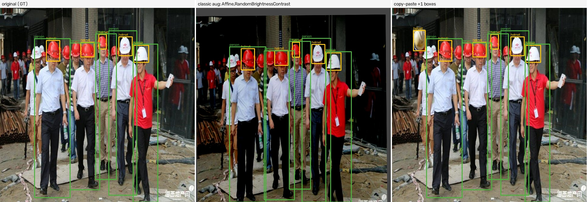
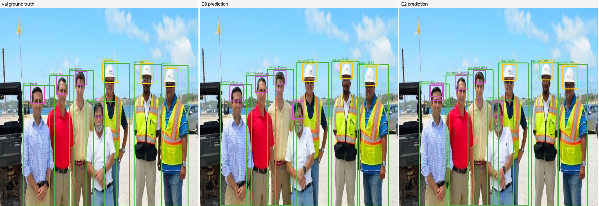

# SynthGuard

*先站得住，再谈好看。*

SynthGuard is a small, opinionated factory for **safety-helmet detection data**: classic
augmentation and copy-paste first, optional diffusion second, always evaluated with a
fixed real validation split. It optimizes for honest comparisons, not pretty fakes.

**Non-goals.** No distance or depth estimation, no point clouds, no multi-sensor
alignment, no SaaS. 2D boxes for `person` and `helmet` only. No promise of higher
accuracy: the promise is a fair experiment you can rerun.

Status: `mvp` (E0 / E2 / E1 at full MVP scale, two seeds; E1 uses a dev-machine stand-in generator).

## Result (MVP profile, main dataset)

construction-safety (Roboflow 100, CC BY 4.0): all 906 seed images, the frozen 300-image
val split, YOLO11n, 60 epochs, imgsz 640, seeds 0 and 1. mAP50 = mean AP50 over person
and helmet; ± is half the seed range. Full table and notes: [`runs/compare.md`](runs/compare.md).

| exp | train data | mAP50 | AP50 person | AP50 helmet | mAP50-95 | Δ mAP50 vs E0 |
|---|---|---:|---:|---:|---:|---:|
| E0 | 906 real | 95.5 ±0.1 | 95.9 | 95.0 | 59.7 | — |
| E2 | 906 real + 453 augmented + 427 copy-paste | 95.1 ±0.2 | 95.7 | 94.5 | 58.9 | −0.3 |
| E1 | E2 data + 362 Krea 2 img2img images (dev stand-in) | 94.8 ±0.5 | 95.2 | 94.4 | 58.9 | −0.7 |

In plain words: on a densely labeled dataset the factory **does not help**. E2 is within
noise of E0 on mAP50 (−0.3) and still slightly behind on mAP50-95 (−0.8, lower on both
seeds), so the boxes it learns are a little looser. A 906-image real baseline is already
at 95 AP50 for both classes, which leaves little to gain.

E1 adds diffusion images on top of E2 and lands 0.7 mAP50 below E0 (inside the 2.0
stop-loss, but no gain). This machine has no FLUX or ControlNet weights, so E1 uses
**Krea 2 Turbo img2img** at strength 0.25 (`generator=krea2_img2img_dev_proxy`): it
re-renders faces, lighting and texture on top of seed images while the layout, and
therefore the boxes, stay put. Without a control net, higher strengths add unlabeled
people or rewrite the scene ([sweep](runs/smoke/gen_sweep.md)); QA rejected 158 of 520
images (scene rewritten 86, extra person 82, person not re-found 7; an image can fail
several checks). The target stack for a real E1 is FLUX.1-dev with Canny/Depth control
on the deploy machine.

**Copy-paste fix, before → after.** The first csafety run clamped paste scales to
[0.5, 2.0], so close-up helmets landed oversized in wide shots. Pastes that would need
more resizing are now skipped (`scale_rejects` in the paste summary). Same E0, E2 retrained:

| MVP E2 | mAP50 | mAP50-95 | Δ mAP50-95 vs E0 |
|---|---:|---:|---:|
| clamped scale ([archived](runs/mvp/archive_paste_clamp/compare_before_fix.md)) | 94.9 | 58.3 | −1.4 |
| skip out-of-range scale (current) | 95.1 | 58.9 | −0.8 |

The fix closes about half of the gap, but E2 still does not beat E0.

Other runs, same protocol:

| profile | dataset | E0 mAP50 | E2 mAP50 | E0 → E2 mAP50-95 |
|---|---|---:|---:|---:|
| [`smoke`](runs/smoke/compare.md) | csafety, 300 seed / 300 val, 30 ep | 94.5 | 94.4 | 57.6 → 56.7 |
| [`mvp_hardhat`](runs/mvp_hardhat/compare.md) (archived) | hard-hat-detection, 1000 / 1000, 416 px | 45.8 | 45.7 | 28.9 → 28.8 |
| [`smoke_hardhat`](runs/smoke_hardhat/compare.md) (archived) | hard-hat-detection, 300 / 300 | 44.0 | 43.7 | 27.1 → 27.2 |

The archived dataset is why the main one changed: it boxes only a small fraction of the
visible people, so person AP stayed near zero in every run and the mean measured label
coverage rather than the factory ([`docs/dataset.md`](docs/dataset.md)).

## What it looks like

Factory side: original → classic augmentation → copy-paste (boxes are ground truth,
propagated or carried, never pseudo-labeled). The pasted helmet (top left of the right
panel) is sized to match the helmets already in the scene.



Model side: a real val image, E0 prediction, E2 prediction.



More in [`assets/examples/`](assets/examples/).

## Why it is built this way

1. **Ground truth first.** Augmentation and copy-paste keep real boxes; generation is seasoning, not the meal.
2. **Fair comparison.** E0 / E2 / E1 share one seed list, one val list, one model and one set of hyper-parameters; synthetic images can never enter val (enforced in code and tests).
3. **Graceful degradation.** No ComfyUI, no weights, or `SKIP_DIFFUSION=1`: the loop still finishes and says why E1 was skipped.
4. **Portable.** Every machine-specific value lives in `.env`; `src/` has no absolute paths (tested).

## Quick start

```bash
pip install -e .
cp .env.example .env
synthguard smoke
```

### Web UI (scene batches for labeling)

```bash
synthguard ui --open            # or double-click scripts/start_ui.bat
```

A local page at `http://127.0.0.1:8765/` with three sections: **生成** (pick a count
with its expected time, see which classes the batch will cover, adjust element ratios,
start, follow progress, stop), **结果** (browse batches, review images with the keyboard,
mark bad ones, download a labeling zip with `classes.txt` and a README for annotators)
and **环境与迁移** (edit `.env`, a health check for GPU / ComfyUI / model files / disk,
and the migration steps). One job at a time; with `--host 0.0.0.0` colleagues can open
it from their own PCs, but only a browser on the machine itself may change `.env`
(unless `--allow-remote-config`). Requests from other web sites and from unknown host
names are refused (add an alias with `--allow-host`). No login: keep it on the internal
network. Deploy notes: [`docs/deploy_3090.md`](docs/deploy_3090.md).

The page is a React + shadcn/ui app in [`web/`](web/README.md). Its production build
is committed to `src/synthguard/ui_static/` and served by the Python standard-library
server, so machines that only run the UI need no Node and no internet (fonts are
bundled).

Exact environment, checksums and timings: [`REPRO.md`](REPRO.md). On a 12 GB RTX 5070
the smoke run takes about 10.5 minutes; the full MVP profile (`synthguard smoke --profile mvp`)
about 31 minutes.

## Data and licenses

- Main source: construction-safety from the Roboflow 100 benchmark, via [`Francesco/construction-safety-gsnvb`](https://huggingface.co/datasets/Francesco/construction-safety-gsnvb), **CC BY 4.0** — attribution: Roboflow 100 / Roboflow Universe contributors. Pinned to one revision, every shard checksummed. Labels remapped (`no-helmet` → `head`, vests dropped).
- Archived source (v0.1 runs): [`Voxel51/hard-hat-detection`](https://huggingface.co/datasets/Voxel51/hard-hat-detection), CC0-1.0 per its card.
- Details and class maps: [`docs/dataset.md`](docs/dataset.md); label rules: [`docs/label_spec.md`](docs/label_spec.md).
- Code: Apache-2.0 ([`LICENSE`](LICENSE)). Data terms: [`DATA_LICENSE`](DATA_LICENSE). Bundled UI libraries, fonts and adapted components: [`THIRD_PARTY_NOTICES.md`](THIRD_PARTY_NOTICES.md).
- Comments and reports that cite "design §x" refer to the project's internal design document, which is not part of this repository.
- **FLUX.1-dev** (the target generator for E1) is under the FLUX.1 [dev] **Non-Commercial** License. Images generated with it must not be sold or packaged as a commercial dataset. The SDXL configuration is a dev-machine stand-in (`generator=sdxl_dev_proxy`), not the target stack.
- Diffusion images depict synthetic persons; no real identity is intentionally depicted.

## Limitations and failure modes

- **Crude copy-paste.** Instances are rectangular crops with feathered edges (no segmentation masks), so pasted people look visibly cut out, and a size match does not guarantee a plausible position or perspective. The scale fix narrowed the mAP50-95 gap from −1.4 to −0.8; this is still the most likely cause of the remaining gap.
- **Strong baseline, small dataset.** 906 real images already reach 95 AP50. construction-safety has only 1206 images, so the design's 1000 + 1000 MVP split is not reachable; val is 300 images.
- **Two seeds only.** Seed spread is small (per-class AP50 differs by up to 1.1 between seeds), but two runs cannot estimate variance; any mAP50 difference under 0.5 is reported as no change.
- **`head` is rare.** Only 24 bare-head boxes in val; it is an auxiliary class and its AP swings widely between seeds (66–77).
- **Domain gap.** These are web photos; gains (or losses) here do not transfer automatically to fixed site cameras.
- **Z0 is partial.** The open-vocabulary labeler needs the `clip` package, which is not in the lock file, so Z0 fell back to the closed-set COCO model: 92.5 AP50 on person, nothing for helmet (no COCO class). Pseudo-labels stay disabled; diffusion QA relies on edge agreement only.
- **Negative transfer guard.** If E1 ever drops more than 2.0 mAP50 below E0, diffusion is switched off and E2 stays the recommended configuration.

## Roadmap

- Deploy machine (2× RTX 3090): FLUX.1-dev conditional generation and the formal E1 — see [`docs/deploy_3090.md`](docs/deploy_3090.md).
- Copy-paste with segmentation masks and perspective-aware placement before adding volume.
- M4 (more classes, data packages): out of scope by default.
